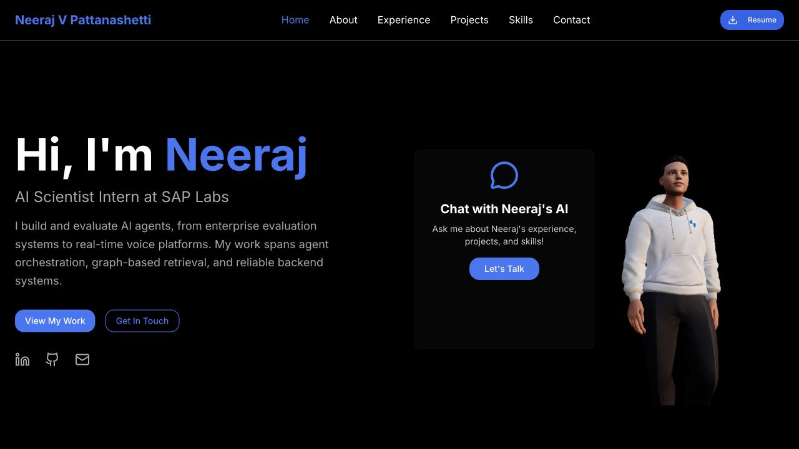
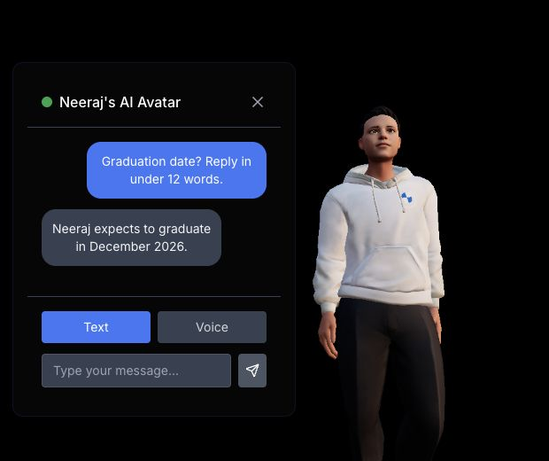
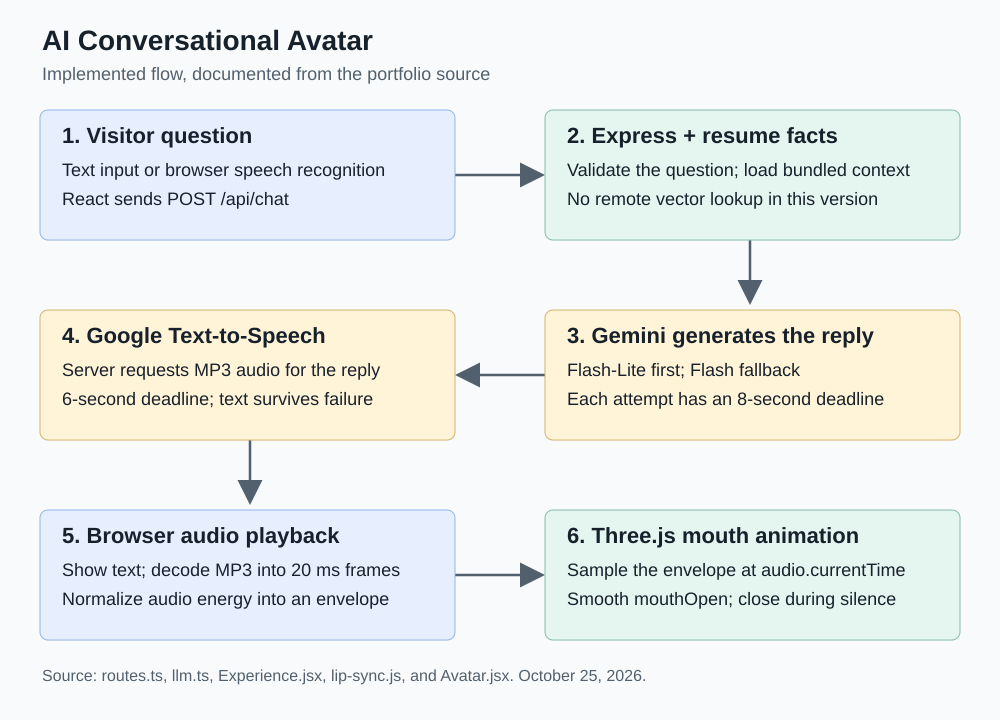

# Neeraj Vijayakumar Pattanashetti – Portfolio

Welcome to my personal portfolio repository! 

## 🚀 Project Overview

This portfolio site serves as a digital showcase of my work, featuring:

- **Interactive UI**: Built with React.js and styled using Tailwind CSS.
- **AI Integration**: Utilizes Google’s **Gemini API** for conversational responses, Text-to-Speech (TTS), and Speech-to-Text (STT) functionalities.
- **Resume Download**: Allows visitors to download my resume directly.
- **Project Showcases**: Highlights various projects with detailed descriptions and technologies used.

## 🔧 Technologies Used

- **Frontend**: React.js, Tailwind CSS, TypeScript
- **Backend / Deployment**: Render
- **AI Integration**: Google Gemini API (Conversational AI, TTS, STT)
- **Other Tools**: Vite, ESLint, Prettier

## 🌐 Live Portfolio

Experience the live version of my portfolio at:  
🔗 [https://neeraj-v-p.onrender.com/](https://neeraj-v-p.onrender.com/)

## 📄 Resume

You can download my resume directly from the website or access it here:  

🔗 [Neeraj_V_Pattanashetti_Resume.pdf](public/Neeraj_V_Pattanashetti_Resume.pdf)

## Development and Deployment

Production is hosted on Render from the `master` branch.
Run `npm ci`, `npm run check`, and `npm test` before deploying.
`npm run build` builds both the Vite client and the TypeScript server;
`npm start` serves the result. The generated server is currently tracked
for compatibility with the existing Render deployment, so include regenerated
`build/server` files when changing server source.

For local development, run `npm run build:server` and `npm start` alongside
`npm run dev`. The Vite API proxy targets the server on port 3000.

Chat uses the current resume facts in `Frontend-Server/resume-context.ts`,
bundled with each deployment. Update that file and the public resume PDF together
when experience, education, or projects change. It no longer queries the older
Pinecone index or downloads an embedding model for resume questions.

Chat requires `GEMINI_API_KEY` and `TEXT_TO_SPEECH_API` in the hosting environment. The optional contact
endpoint uses `SMTP_APP_PASSWORD` and optionally `SMTP_USER`; the contact
form is currently hidden. Never commit credentials.

`GET /api/health` reports server availability and Render's deployed commit.

## Avatar Case Study

### Objective

Make the portfolio conversational so visitors can ask about experience, projects,
and skills. The application combines a React interface, a Three.js avatar rendered
through React Three Fiber, and an Express server that generates short replies
from the current resume.

### Implementation

The server validates visitor questions and includes the bundled resume facts in
a Gemini request. Flash-Lite is tried first, with Flash as a fallback and an
eight-second deadline per attempt. Google Text-to-Speech returns MP3 audio.
In the browser, `lip-sync.js` measures audio energy in 20 ms frames, normalizes
the envelope, and samples it at the current playback time. `Avatar.jsx` smoothly
applies that value to the model's `mouthOpen` morph target.

### Challenges and Results

The earlier remote resume retrieval could delay answers and retain outdated
facts. Bundling the short resume with the application removes that lookup.
Speech synthesis has a six-second deadline and returns the successful text answer
even when audio is unavailable. Tests cover model fallback, timeout handling,
speech-envelope timing, silence, the shipped mouth morph target, and the served
resume. AI provider response times still vary; this is not a guaranteed latency.

### Visual Evidence

These two screenshots were captured from the public application on October 25,
2026. The third visual documents the implemented source-code flow. The same
figures and captions appear in the [live case study](https://neeraj-v-p.onrender.com/#avatar-case-study).

#### 1. Working desktop interface

The avatar is rendered alongside the conversation entry point and the portfolio
navigation. This captures the implemented interface rather than a design mockup.

#### 2. Real resume-grounded conversation

The visitor asks when Neeraj graduates. The reply uses current education details
from the server's bundled resume context. This screenshot shows the actual
question and response, not a scripted conversation image.

#### 3. Implemented request and audio flow

The diagram traces `routes.ts`, `llm.ts`, `Experience.jsx`, `lip-sync.js`, and
`Avatar.jsx`: validation and context, model generation, speech synthesis, browser
playback, and mouth animation. The server coordinates both external provider
requests; text remains usable when speech synthesis fails.

## Contact Details

Feel free to reach out:  

- **Email**: [neerajvpattanashetti@gmail.com](mailto:neerajvpattanashetti@gmail.com)  
- **LinkedIn**: [Neeraj VP](https://www.linkedin.com/in/neeraj-vijayakumar-pattanashetti-613305239/)
